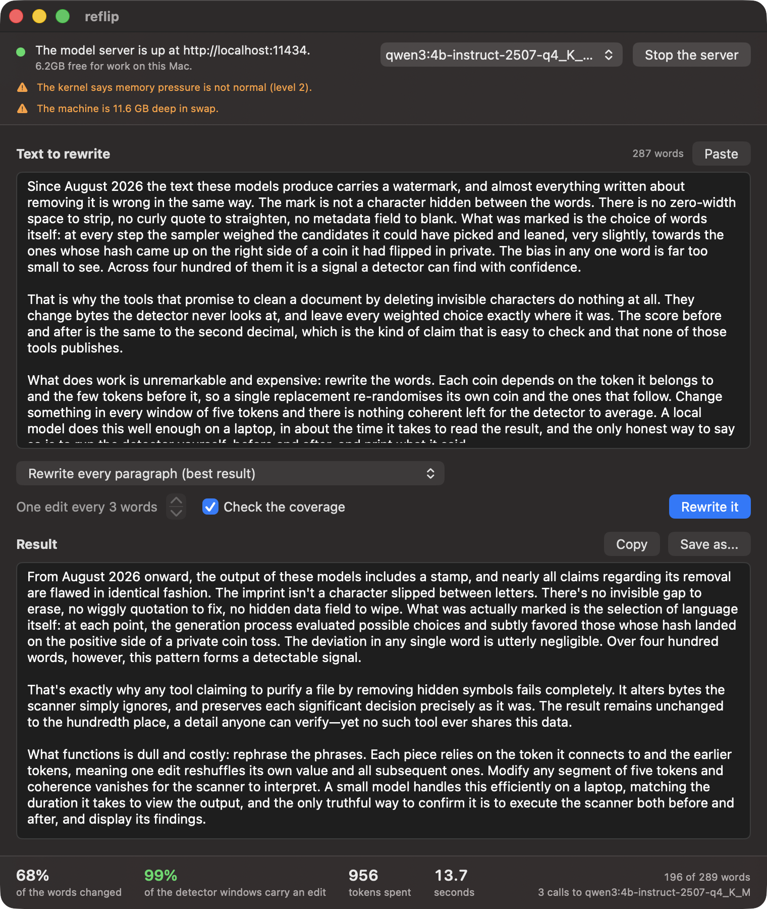
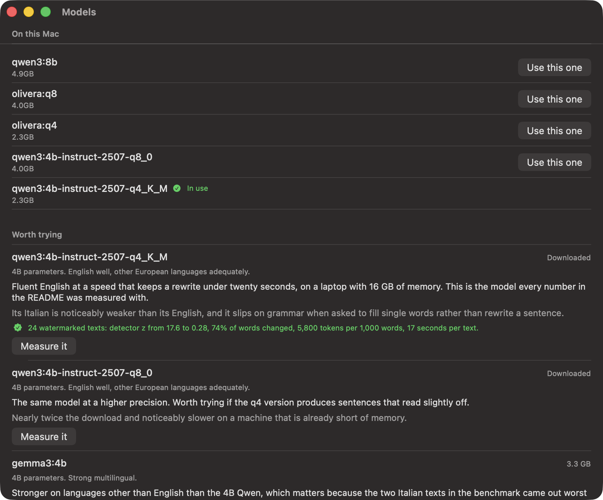

# reflip

Nobody outside Anthropic can tell you whether a Claude text still carries its watermark, and reflip cannot either.

What reflip does is measure. It rewrites text with a local model until a SynthID-style watermark stops registering on the published detector, checked with a secret of its own on an open model. It checks that the rewrite kept the numbers, names, negations and quantifiers. And it estimates whether a text was written by a model, with the error it measured and a refusal wherever that error is too large to say anything. The same tools run in a browser, on the reader's own device: [nerln.github.io/reflip/app](https://nerln.github.io/reflip/app/).

Since 2 August 2026 Claude's text carries a statistical watermark, "a version of the SynthID-Text approach" in Anthropic's words. The watermark is a bias in which words were chosen; it is not a hidden character, and nobody outside Anthropic holds the secret that reads it. Every number below comes from reflip's own check and can be reproduced with the commands next to it.

- **With the default local model, nothing leaves your machine.** The rewriter is a 2.5 GB model under Ollama. Any OpenAI-compatible endpoint works too, and then the text goes to that endpoint.
- **The measurement is the product.** The rewriting is ordinary; the detector before and after, the share of watermark positions left untouched, the facts kept and the tokens spent are what the forty-odd other "Claude watermark removers" do not publish.
- **It says what it cannot know.** Anthropic's secret, context length and detector are private. The benchmark uses the published algorithm at its published settings; the threat-model section says how the answer moves if theirs differ.
- **What it is for.** Measuring what an edit does to a text: to a watermark, to its facts, to a detector's score. It is not built to decide things about people, such as grading, hiring or accusing someone of using a model, and its detection answers are worded so that they cannot be read that way.

## What the numbers say

24 watermarked texts of 144 to 420 tokens, detector z-score before and after each transform. z is the number of standard deviations above chance; unwatermarked text lands between -2 and +2, and z above 4 happens once in thirty thousand by accident. Run on 22 October 2026 with the facts guard on; full tables with medians, the weighted-mean score DeepMind's code recommends, cosine similarity and the per-sample texts: `data/results/facts/` and `data/results/facts-coverage/` (the run before the guard: `data/results/main/`).

| transform | z before | z after (mean) | z after (max) | z below 4 | positions intact | facts changed per 1,000 words | words changed | LLM tokens per 1,000 words | seconds per text |
|---|---|---|---|---|---|---|---|---|---|
| none | 17.6 | 17.5 | 25.3 | 0 of 24 | 0.99 | 0.0 | 0% | 0 | 0 |
| unicode strip | 17.6 | 17.5 | 25.3 | 0 of 24 | 0.99 | 0.0 | 0% | 0 | 0 |
| rules, no model | 17.6 | 15.8 | 24.8 | 0 of 24 | 0.90 | 0.5 | 2% | 0 | 0 |
| infill, stride 4 | 17.6 | 1.3 | 13.5 | 22 of 24 | 0.11 | 3.3 | 28% | 9,140 | 22 |
| infill, stride 3 | 17.6 | 1.3 | 7.8 | 22 of 24 | 0.07 | 5.0 | 39% | 12,534 | 31 |
| infill, stride 2 | 17.6 | 0.8 | 6.1 | 22 of 24 | 0.06 | 8.5 | 62% | 17,343 | 44 |
| rules, then infill (stride 3) | 17.6 | 1.5 | 9.0 | 21 of 24 | 0.08 | 4.9 | 42% | 12,430 | 30 |
| paraphrase | 17.6 | 0.5 | 5.6 | 22 of 24 | 0.05 | 24.9 | 67% | 14,478 | 28 |
| paraphrase, coverage-checked (default with `--tokenizer`) | 17.6 | 0.5 | 5.6 | 22 of 24 | 0.05 | 25.2 | 68% | 15,142 | 29 |
| unwatermarked controls (23) | 0.0 | -0.1 | 1.2 | 23 of 23 | 0.99 | 0.0 | 0% | 0 | 0 |

Rewriter: `qwen3:4b-instruct-2507-q4_K_M` under Ollama on a 16 GB Apple Silicon laptop, temperature 0.7. Watermarked texts: Qwen2.5-1.5B-Instruct with the open SynthID-Text processor (context 4 tokens, 9 keys). "Positions intact" is measured on the re-tokenised edited text and is the quantity the theory is about: 0.05 means 95% of the detector's coins were re-flipped. The identity row sits at 0.99 rather than 1.00 because two texts do not survive a decode/encode round trip byte for byte; that is the floor for every row. "Facts changed" is `reflip diff` between the original and the rewrite (see below).

What the table settles:

1. **Stripping invisible characters does nothing.** Same score to the second decimal. This is what most "remover" sites do.
2. **Rules without a model do not get there.** Contractions, spelling variants, dashes and stock phrases change 2% of the words and take a tenth off the score. Removal needs an edit in every window of five tokens, and rules cannot supply that density.
3. **One edit per window is enough, on real text.** Every model-driven row re-randomises 89 to 95% of the detector's positions, and the mean score drops from 17.6 to between 0.5 and 1.5, inside the range of unwatermarked text. The theory that predicted this is in `tests/test_synthid.py`, without any language model.
4. **If the facts matter, use `infill`.** With numbers, names, negations and quantifiers kept out of its slots, slot filling changes 5.0 facts per thousand words at stride 3, against 24.9 for the paraphrase, and gets as many texts below 4 (22 of 24) for fewer tokens. Before the guard it changed 22.3, and the paraphrase 32.7. The paraphrase still reads better: slot filling leaves grammar slips a reader notices, which is why `paraphrase` stays the default.
5. **The guard has a price on the paraphrase.** Asking again for every paragraph that changed a fact took it from 5,100 to 14,478 tokens per thousand words and from 15 to 28 seconds, for 32.7 down to 24.9 facts changed. It also costs removal in Italian: when the model cannot rewrite a paragraph without changing a fact, the attempt that kept the facts wins, and the two Italian texts stay at z 5.6 and 4.9. Before the guard, the coverage-checked paraphrase brought all 24 texts below 4 (maximum 2.4); now 22, and all 22 English ones. A rewriter more fluent in Italian is the fix, not a looser guard.

## Why the "watermark remover" websites do nothing

At every step, the sampler hashes a secret together with the previous 4 tokens and each candidate token into a coin flip (a "g-value"), and nudges the choice toward candidates whose coins came up 1. The detector recomputes the same coins for a text and checks whether their mean is above 0.5. Stripping zero-width spaces, curly quotes or metadata leaves every coin exactly where it was. `reflip check` still lists the invisible characters in a file, because that is the only thing anyone can check without the secret.

## Why one edit in five tokens is enough

Each coin depends on a token **and the 4 tokens before it**. Change one token, and the detector's recomputed coins for that token and for the 4 that follow it become fresh, unbiased flips: their hash context is no longer the one the sampler saw. If every window of 5 consecutive tokens contains at least one edited token, every coin is re-randomised, and both the mean and the weighted-mean scores fall back to what unwatermarked text gets, whatever the strength of the watermark. That is one edit in five tokens, about one word in three or four.

`tests/test_synthid.py` shows this without a language model: a toy generator that picks, among random candidates, the one with the most 1-coins scores z above 10 on 300 tokens; replacing every 5th token brings it below 4; replacing every 10th halves it. The benchmark shows it on real text, after re-tokenisation.

## What is verified, and what is not

- Verified: on the open SynthID-Text implementation (`transformers`' `SynthIDTextWatermarkLogitsProcessor`, ngram length 5, 9 keys, the paper's settings) applied to an open model, each transform's effect on the mean-g detector and on the weighted-mean detector, the share of positions left intact, meaning kept, words changed, tokens and time.
- Not verified, because it cannot be: Anthropic's secret, context length, number of layers and detector. Anthropic says the watermark "may persist through some editing" and that "a complete rewrite where every word is replaced will" remove it, which is what the paraphrase row measures.

## Install

```bash
git clone https://github.com/nerln/reflip
pip install -e "./reflip[bench]"      # [bench] adds torch and transformers, needed for the coverage check and the benchmark
ollama pull qwen3:4b-instruct-2507-q4_K_M
```

## Use

```bash
reflip run draft.md -o clean.md                                    # paraphrase with the local model
reflip run draft.md --tokenizer Qwen/Qwen2.5-1.5B-Instruct -o clean.md   # same, and re-ask until 90% of 5-token windows carry an edit; prints the coverage
reflip run draft.md --transform infill --stride 3 -o clean.md      # keeps facts best (5 changed per 1,000 words), some grammar slips
reflip run draft.md --transform rules -o clean.md                  # no model at all: partial, see the table
reflip check draft.md                                              # invisible characters, and what cannot be checked
```

Any OpenAI-compatible endpoint works as the rewriter: `--base-url https://api.deepseek.com/v1 --api-key ... --model deepseek-chat`. <!-- stylecheck: allow, the flag is named --api-key --> Never use a rewriter that watermarks its own output: Gemini does, and Claude models launched since August 2026 do. Models run under Ollama, llama.cpp or vLLM carry no watermark unless the operator adds one.

The coverage figure needs a tokenizer to count windows. Claude's is not public; the benchmark model's tokenizer is a proxy of similar granularity, and the threshold leaves margin.

## Checking the facts

A paraphrase that reads well can still say something else: a figure dropped, a name gone, a "not" lost, "most" turned into "all". On the October benchmark the model-driven rewrites changed 20 to 34 such facts per thousand words. `reflip diff` counts them without a model:

```bash
reflip diff before.md after.md          # exit 1 if anything changed
reflip diff before.md after.md --json   # the same, for a program
```

Before: "The trial enrolled 412 patients over 18 months at three hospitals in Lyon. Most participants did not report side effects." After: "Over 16 months, three hospitals in Lyon took part in the trial. All participants reported no side effects."

```
5 facts changed (277.8 per 1,000 words).
Numbers: gone 18, 412; new 16.
Quantifiers: gone most; new all.
```

It reads numbers written as digits or as words in English, Italian and Spanish ("three million" and "3 million" are the same number, so is "trecentoquarantacinque" and 345), names (capitalised words that do not open a sentence, a line or a heading), negations and quantifiers. Every rewrite runs through it: `paraphrase` asks again for any paragraph that changed one of them, `infill` never offers one of those words to the model, and `reflip rewrite` reports `"ok": false` with exit code 3 if any are still changed at the end, keeping the text so you can look. It is a check, not a proof: a claim reworded with every number and name in place is invisible to it.

## Telling machine text from human text

```bash
reflip detect essay.md            # sentences for a person
reflip detect essay.md --json     # the same answer as numbers
reflip detect essay.md --watermark --watermark-keys 1,2,3   # also read a SynthID-style watermark whose keys you hold
```

Two families of evidence, and they are not the same kind of thing. **A watermark** is proof, for whoever holds its secret: reflip reads the SynthID-style watermark of its own benchmark, because it holds that secret. It cannot read Anthropic's (on Claude models launched since 2 August 2026) or Google's, and nothing outside those companies can; every answer says so. **Zero-shot detectors** need no secret and prove nothing on their own: machine text tends to be more predictable to a language model, and Binoculars, Fast-DetectGPT, perplexity and burstiness turn that tendency into a score.

How far a score can be trusted was measured, under a protocol written before any detector ran (`docs/detect/PREREG.md`): 3,520 human texts (Wikipedia, and BBC, Il Post and El País articles) and 432 machine texts from three model families, in English, Italian and Spanish, at three lengths, plus 45 machine texts rewritten by reflip and 300 essays by people writing English or Spanish as a second language. Thresholds were set on one half and every number comes from the other. Binoculars on the Qwen2.5 1.5B pair won by the pre-registered rule (mean AUROC 0.965 on medium and long texts).

| | short (40 to 99 words) | medium (100 to 300) | long (301 to 600) |
|---|---|---|---|
| English | AUROC 0.83, refused | 0.92, refused: catches 46% | **0.97, verdict given**: catches 50%, flagged 0 of 300 humans |
| Italian | 0.82, refused | 0.94, refused: flagged 10 of 300 | 0.99, refused: flagged 2 of 220 |
| Spanish | 0.88, refused | 0.98, refused: flagged 11 of 300 | 0.98, refused: flagged 2 of 300 |

A verdict is given only where the AUROC's 95% lower bound is at least 0.85, the threshold catches at least half of the machine texts, and the false-positive rate is under 2% at the top of its 95% interval. That is one cell of nine. Everywhere else `reflip detect` refuses and prints the numbers that made it refuse. What it always prints is how many of the measured human texts of that length scored at least as machine-like as yours: that number needs no assumption about who usually sends texts to the tool, and it is the one that matters to a person being accused. There is no probability, on purpose.

Three more findings:

- **reflip's own rewrites get past it.** Machine text rewritten by reflip scores an AUROC of 0.56 (medium) and 0.71 (long) against human text, where the same kind of text unrewritten scores 0.95 and 0.98.
- **Claude is the hardest to tell apart.** Text from Claude Haiku 5.5 scores 0.75, 0.92 and 0.95 at the three lengths; the two local 4B models, 0.85 to 0.99.
- **Second-language writers.** At the threshold, 0 of 135 English learner essays were flagged, and 3 of 130 Spanish ones (2.3%, up to 5.9%). The versions a teacher corrected were flagged more: 7 of 132. No open corpus of Italian learners was found, and the answer says so for Italian.

The strict rule is what keeps most cells refused: with about 300 test humans per cell, the 2% bound allows one false positive, and a threshold aimed at 1% flags about three. Thresholds per language, tried after seeing the results, did worse (`data/results/detect/exploratory-per-language.md`). Reproduce: `python -m reflip.detect_corpus humans` (and `requests`, `generate`, `learners`, `rewrite`), then `python -m reflip.detect_bench score --pair qwen2.5-1.5b` and `evaluate`. The human texts are not in the repository; `docs/detect/corpus-manifest.json` says where each one came from.

## In your browser

[nerln.github.io/reflip/app](https://nerln.github.io/reflip/app/) runs the facts check, detection and rewriting on the reader's device. The text never leaves it, and the page is built so that this does not rest on a promise:

- **A network lock.** While a text is being processed, `fetch`, `XMLHttpRequest`, `sendBeacon`, `WebSocket`, `EventSource` and image loads throw, in the page and inside the worker that runs the models. Models are downloaded before the lock goes on, and are read from the device after.
- **A Content-Security-Policy** that lets the page connect only to itself, to Hugging Face for model files and to the counter. A policy in a `<meta>` tag does not reach a worker loaded from its own file, and GitHub Pages cannot send headers, so inside the worker the lock is the wall.
- **Counting that has nowhere to put a text.** The page counts four fields: the format version, what happened (a page opened, a model downloaded, a tool used), which page, and which model, each from a closed list that the page and the counter both enforce. Not the text, its length, a hash, its language, a score or a verdict. The counter keeps one total per day and combination and nothing else. The page shows every request it has sent, as sent. Global Privacy Control and Do Not Track turn counting off.
- **A test that fails when any of this breaks.** `web/test/privacy.test.mjs` runs the page in headless Chrome with a hostile engine that tries to send the pasted text out by every route above while it "processes". It fails if one request leaves, or if a statistics payload has a value off the list, four characters in a row of the text, or a number other than the format version. Switching the lock off makes it fail.

Model files are pinned to a commit and checked against a SHA-256 as they stream in, then kept in the browser's private file system until the page's delete button or the browser's settings remove them.

What the measurements decided:

- **The detector runs on the processor, and gives no verdict anywhere.** The browser downloads the 0.5B pair as 4-bit files with 16-bit arithmetic (966 MB), the largest a browser handles comfortably. Measured on the same corpus, it reaches a mean AUROC of 0.947, but no language and length passes the rule (its best cell, Italian long, catches 80% and flagged 3 of 220 humans), so the page shows the share of human texts that scored as high and the reason it will not say more. On the processor, in the browser, they reproduce the scores onnxruntime gave on the same files to the third decimal (Binoculars 0.9957 against 0.9952 on a 251-token text, 1.0225 against 1.0235 on a 512-token one), so the numbers measured in Python describe what the page computes. On WebGPU the same files gave 1.245, and wrote "Th Th Th" when asked to rewrite, in Chrome 152 and in the Claude app's browser alike, on an Apple GPU. A 512-token text takes about 25 seconds.
- **Rewriting runs on WebGPU**, with 4-bit files that keep 32-bit arithmetic: they wrote what the processor wrote, in 4 seconds instead of 215. Measured over the 24 watermarked texts, scored with the benchmark's detector:

| browser model | download | z after (mean) | z after (max) | z below 4 | positions intact | facts changed per 1,000 words | words changed | seconds per text |
|---|---|---|---|---|---|---|---|---|
| Qwen2.5 0.5B Instruct | 786 MB | 2.0 | 18.1 | 22 of 24 | 0.12 | 22.8 | 61% | 27 |
| Gemma 3 1B | 859 MB | 1.2 | 10.6 | 21 of 24 | 0.08 | 25.7 | 59% | 35 |

  Both are weaker than the command line's 4B model. Qwen2.5 1.5B, the next size up, does not fit: its single 1.8 GB file stops with `std::bad_alloc`. Llama 3.2 1B loads, and was left out after it wrote up to eight times the length of the original and changed 112 facts per thousand words. The replies are cleaned of the announcements small models put around a rewrite ("Okay, here's a revised version:"), which Gemma did in 14 of 24 texts before the cleaning existed.

## The window

```bash
cd macapp && ./build.sh && open Reflip.app
```



A second window lists the models: what is downloaded, what is worth trying with a sentence
on what each one is bad at, and a search over Hugging Face. A claim that was measured is
marked as measured and looks nothing like an opinion.



The figures along the bottom of that picture are a real run of the paragraph above them,
on the laptop this was built on. The picture is regenerated by the app itself, never
staged by hand.

One window, one column, the text running down it: the model server at the top with a
button that starts it, the text you paste, the button that rewrites it, the result, and
at the bottom the numbers that came back. The window decides nothing. Every button is a
command below that you could have typed, and every sentence it shows was written by the
tool rather than by the interface, so the two can never disagree about why something did
not happen.

Starting the server from the window starts one only if nothing is already listening, and
quitting stops only a server that reflip itself started. A server that was up before you
arrived belongs to whoever started it and is left alone.

## For agents and scripts

Four commands print one line of JSON, so a program can run the whole thing without
reading prose. Every object carries `"v": 1`.

```bash
reflip server status --json      # is the server up, is the model there, what can this Mac spare
reflip server start --json       # start one if nothing is listening
reflip pull MODEL --json         # JSON Lines: {"event":"pull","completed":n,"total":n}
reflip rewrite - --json --progress < draft.md > result.json
```

`rewrite` reads the file or standard input and prints the rewritten text together with
what it cost: words changed, coverage of the detector windows, calls, tokens, seconds.
With `--progress` it also writes JSON Lines to standard error while it works, so a
caller can show a progress bar without parsing the result out of the middle of it.
Refusals come back as `{"ok": false, "reason": "a sentence"}` and exit 1: 0 is success,
1 an expected refusal, 2 a usage mistake, 130 an interrupt.

An agent that has been asked to take a watermark out of a text runs one command:

```bash
reflip rewrite draft.md --json --progress
```

The independent pieces of a text are rewritten several at a time. How many is read from
the kernel rather than guessed, because a laptop that has started swapping finishes
later with four in flight than with one: `hw.perflevel0.logicalcpu` for the performance
cores, `host_statistics64` for what memory is really free, `kern.memorystatus_vm_pressure_level`
for whether the machine is already in trouble. `reflip server status --json` shows that
reading, and every refusal it produces comes with the sentence explaining it. On an idle
machine a 343-word text took 20 seconds one piece at a time and 15 seconds four at a
time, with identical output.

## Which model to rewrite with

```bash
reflip models --recommended        # what is worth trying, and what each one is bad at
reflip models --search "gemma 3"   # anything published as a GGUF file on Hugging Face
reflip models --measure gemma3:4b  # run it over watermarked texts and see what the detector said
```

The catalogue is opinions, and it says so. `--measure` is the way to disagree with it: it
runs the model over watermarked texts from the benchmark corpus and reports the detector
before and after, the coverage, the share of words changed, the seconds and the tokens,
then one sentence saying whether that is good enough. The default model measures at
detector z 13.3 down to 0.65 with 98% coverage on this laptop.

Anything published as GGUF can be pulled straight from Hugging Face, because the local
server accepts a repository reference:

```bash
reflip pull hf.co/bartowski/Qwen2.5-7B-Instruct-GGUF:Q4_K_M
```

One rule is not a preference. A model that watermarks its own output is refused rather
than ranked, because rewriting with it swaps one watermark for another. That covers
Claude models launched since August 2026 and the Gemini service. Gemma's open weights are
fine: SynthID is applied while sampling, and a local server does not apply it.

## Writing your own transform

Anything in `~/.reflip/transforms/*.py` is loaded at startup, so a transform of your own
appears in `reflip transforms` and in the window's picker without rebuilding either:

```python
from reflip.transforms import Options, TransformResult, register
from reflip.words import apply_replacements, choose_slots, words

@register("shout")
def shout(text: str, opts: Options) -> TransformResult:
    ws = words(text)
    picked = choose_slots(ws, opts.stride)   # one word in every opts.stride
    return TransformResult(text=apply_replacements(text, ws, {i: ws[i].text.upper() for i in picked}),
                           edits=len(picked), notes={})
```

`choose_slots` is the part worth reusing: it picks the fewest words that still leave no
run of unedited text longer than the stride, preferring content words. A file that fails
to import is skipped and named on standard error rather than taking the built-in
transforms down with it.

## Benchmark

Reproduce: `reflip corpus --attn eager` (generates the watermarked and control texts, about 15 minutes on an M-series Mac), then `reflip bench --sweep-stride 2,3,4`. Transform outputs are cached, so re-scoring with other settings does not call the model again.

- **Corpus.** 24 prompts (22 English, 2 Italian: essays, emails, explanations, a story, a memo, a review) completed at temperature 0.9, top-p 0.95, with the watermark, and 23 completions of the same prompts without it as controls. Watermarked completions score between 8.6 and 25.3; controls between -1.6 and +1.2.
- **Detector.** Mean g-value, the paper's simplest score, and the weighted-mean score DeepMind's reference code recommends, both as z-scores against the unwatermarked null.
- **Intact.** The fraction of positions whose g-value the detector recomputes unchanged, measured on the re-tokenised edited text.
- **Facts.** Numbers (digits and words, in English, Italian and Spanish), names, negations and quantifiers that the rewrite dropped or added, per thousand words of the original (`reflip/facts.py`, the same check `reflip diff` runs). It replaced the cosine similarity of sentence embeddings as the headline quality number: on the October benchmark every model-driven row kept a cosine between 0.955 and 0.972 while changing 20 to 34 facts per thousand words (the coverage-checked paraphrase: 34).
- **Cost.** Share of words changed, LLM tokens per thousand input words, wall time. The cosine similarity of multilingual-e5-small embeddings is still in `summary.md`.

## What the other tools do

More than forty "Claude watermark remover" repositories and sites appeared in August 2026. They fall into three groups: invisible-character strippers (verifiable, and irrelevant to the statistical watermark; several miss variation selectors), "rewrite it with another model" wrappers with no measurement, and a few measurement studies that decline to claim removal. None publishes before-and-after numbers against a SynthID-class detector together with a quality cost. That gap is what this repository fills.

## Related work

- **SynthID-Text** (Dathathri et al., *Nature*, 2024) is the watermark this benchmark reimplements, through the open `transformers` processor.
- **Paraphrasing evades detectors** (Krishna et al., 2023) showed that a paraphrase model (DIPPER) breaks both watermarks and zero-shot detectors, and proposed retrieval as a defence. reflip's paraphrase row is the same finding on a SynthID-class watermark, with the facts it costs.
- **MarkMyWords** (Piet et al., 2023) and **MarkLLM** (Pan et al., 2024) benchmark and implement text watermarks, robustness to rewriting included.
- **RAID** (Dugan et al., 2024) measures machine-text detectors across generators, domains and adversarial edits, paraphrase among them; **AuTexTification** (IberLEF 2023) ran the same question as a shared task in English and Spanish.
- **Binoculars** (Hans et al., 2024) and **Fast-DetectGPT** (Bao et al., 2024) are the two zero-shot detectors `reflip detect` uses. **Liang et al.** (2023) found that perplexity-based detectors flag people writing in a second language, which is why reflip measures them apart and says so in every answer.

## Threat model, honestly

- **Context length.** The published SynthID-Text uses the previous 4 tokens (the Nature paper: "we use H = 4"), and Anthropic's description is "a few words that come before". A longer context means one edit re-randomises more coins and a sparser rewrite would do; a shorter one needs a denser rewrite. The paraphrase row changes 72% of the words and does not depend on the context length in any realistic range.
- **Tokenizer.** Anthropic's is not public. Word-level strides do not depend on it; the coverage check uses a proxy tokenizer of similar granularity.
- **Detector.** Anthropic may run a trained detector rather than the mean score. Every such detector is a function of the same g-values; once they are re-randomised there is nothing left to weight. Partial removal, the rules row, is where detectors differ, which is why both scores are reported.
- **Repeated contexts.** SynthID does not watermark a position whose 4-token context already appeared in the text, and the detector masks the same positions. The benchmark scores exactly what the detector would see, so this is inside the numbers.
- **Low-entropy text.** Code, lists of facts and very short texts carry little watermark to begin with, as Anthropic also says. The tool leaves code blocks, URLs, e-mails and placeholders untouched.

## Licence

MIT.
